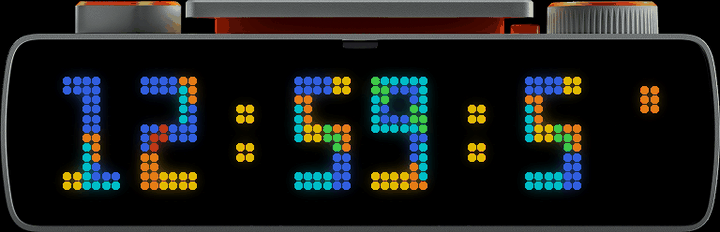

# Tetris clock for the BUSY Bar

A clock app for the [BUSY Bar](https://busy.app), inspired by a famous game.

## Install

1. Update the bar to [VeryBUSY](https://code.mccullough.dev/christian/VeryBUSY/releases)
   r14 or newer.
2. On the bar's Web UI, Apps tab, find **Tetris Clock** in the catalogue and
   install it.
3. Open Apps on the bar and start **Tetris Clock**.

Until it shows up in the catalogue, download `Tetris.fap` from the
[releases](../../releases) and upload it on the Apps tab.

## Controls

On the clock, tap the wheel to switch the animation on or off. Turn it to
change the colour. Back opens the Start screen.

Setup has the rest: colour, 12h or 24h, seconds on or off, how the seconds
animate, speed, the colon and the animation switch.

## Build

Only if you want to build it yourself. `scripts/build.sh` downloads VeryBUSY,
builds the app and puts it in `dist/Tetris.fap`. Upload that file on the Apps
tab of the Web UI.

## Credits and license

The app shell (Start and Setup screens) and the build come from VeryBUSY by
Christian McCullough. The BUSY Bar picture in `docs/` is Flipper Devices'
render, used under CC-BY 4.0. Unofficial project, not affiliated with Flipper
Devices or BUSY.

Code: GPL-2.0-or-later
